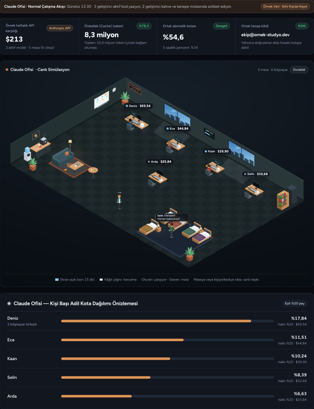
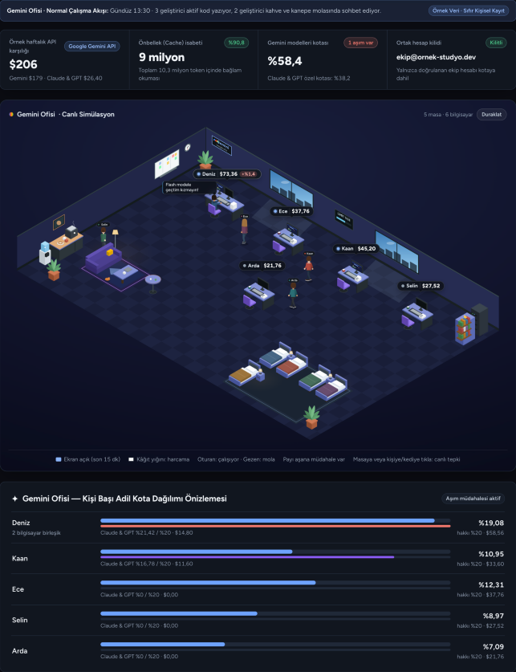
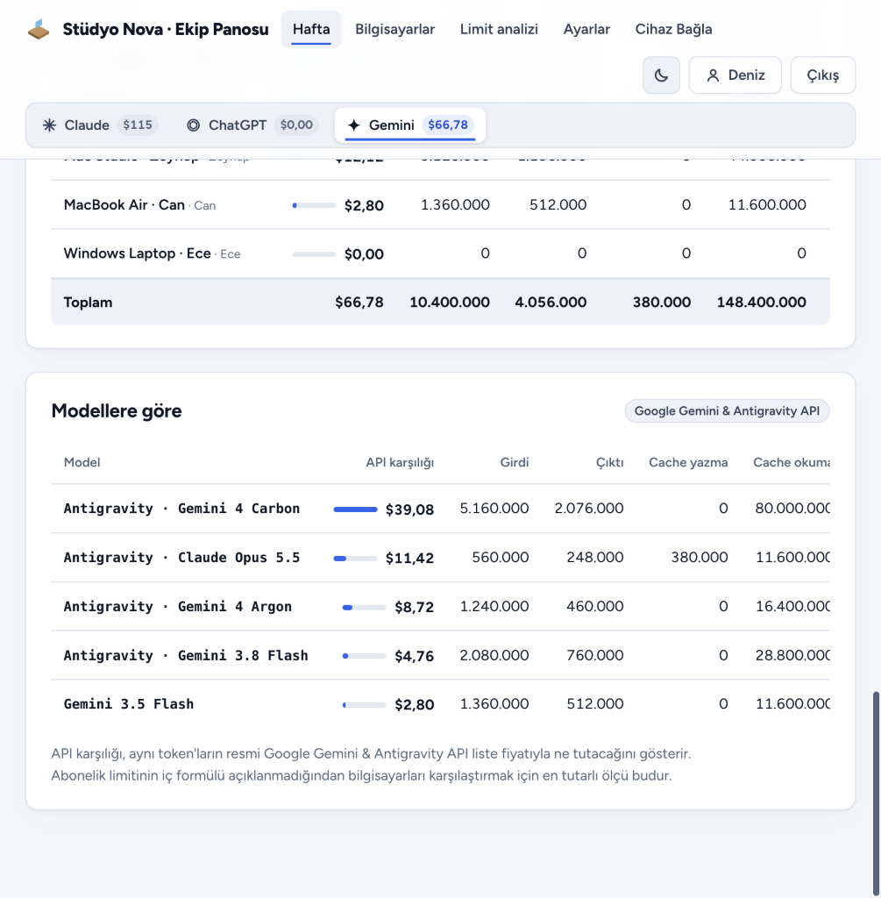
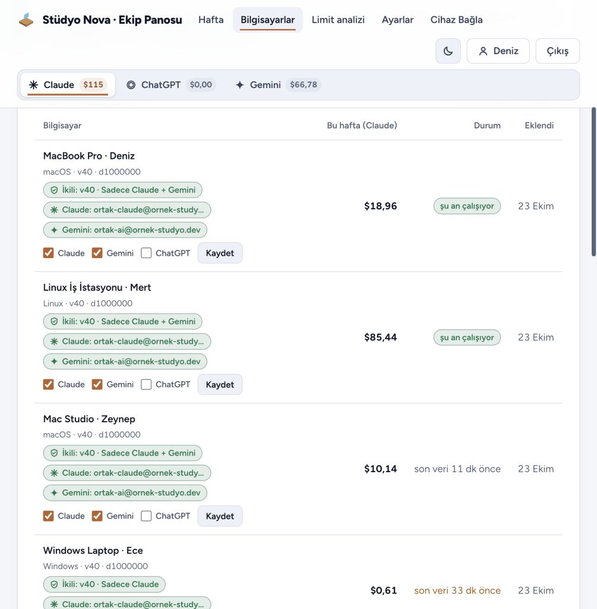
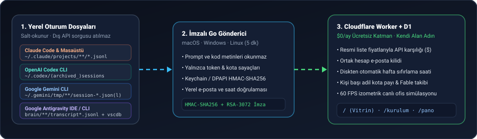

<div align="center">

# Token Panosu `v41`

**Claude Code, OpenAI Codex CLI, Google Gemini CLI ve Google Antigravity IDE/CLI için sıfır maliyetli, derleme seviyesinde izole göndericili ve 60 FPS izometrik canlı ofis simülasyonlu açık kaynak ekip kota & token panosu.**

[](https://github.com/doganau/token-panosu/releases)
[](./LICENSE)
[-f59e0b.svg)](#hızlı-kurulum-cloudflare-workers--d1)
[-38bdf8.svg)](#sağlayıcı-bazlı-derleme-izolasyonu-ve-kriptografik-mühür)

<br>



</div>

---

## Gerçek Simülasyon ve Pano Ekran Görüntüleri

<table>
  <tr>
    <td width="50%" valign="top">
      
      <p align="center"><sub><b>Gemini & Antigravity Ofisi:</b> Karakterlere bitişik minimal mikro sohbet balonları ve çift kota havuzu (<code>Gemini Modelleri</code> + <code>Claude & GPT</code> özel kotası)</sub></p>
    </td>
    <td width="50%" valign="top">
      
      <p align="center"><sub><b>Gerçek API Modelleri & Resmi USD Tarifesi:</b> SQLite <code>gen_metadata</code> üzerinden <code>Gemini 4 Carbon</code>, <code>Gemini 4 Argon</code>, <code>Gemini 3.8 Flash</code>, <code>Claude Opus 5.5</code> ve <code>GPT-OSS 120B</code> ayrıştırması</sub></p>
    </td>
  </tr>
  <tr>
    <td colspan="2">
      
      <p align="center"><sub><b>Derleme Seviyesinde Sağlayıcı İzolasyonu (v41):</b> Bilgisayar yalnızca izin verilen sağlayıcıların (ör. <code>cm</code> = Sadece Claude + Gemini) okuma koduna sahip ikiliyi çalıştırır</sub></p>
    </td>
  </tr>
</table>

---

## Neden Token Panosu?

Ortak **Claude Team / Max**, **ChatGPT Plus / Pro** veya **Google AI / Antigravity** aboneliği kullanan yazılım ekiplerinde kimin haftalık kotanın ne kadarını tükettiği, önbellek (prompt cache) verimliliği ve kota pencerelerinin ne zaman sıfırlanacağı görünmezdir.

**Token Panosu**, hiçbir sağlayıcıya dış ağ isteği atmadan ve hiçbir sohbet metnini ya da kaynak kodunu okumadan bilgisayarınızdaki yerel oturum sayaçlarını salt-okunur tarar; resmî API liste fiyatlarıyla adil harcama karşılığını hesaplar ve ekibinizi **60 FPS izometrik canlı ofis simülasyonunda** bir araya getirir:

- **Sahneyi Kapatmayan Canlı İzometrik Ofis Simülasyonu:** Son 15 dakikada kod yazan ekip üyeleri masasında parlayan monitörüyle çalışır, harcama arttıkça masadaki kâğıt yığını yükselir, moladakiler kahve makinesi ve kanepede sohbet eder, gece saatlerinde çalışmayanlar uyku köşesine geçer; karakter tepkileri sahneyi örten devasa kutular yerine **insan figürlerine bitişik, yer kaplamayan minimal mikro sohbet balonlarıyla** gösterilir.
- **Kusursuz Çift Havuzlu Google Gemini & Antigravity Muhasebesi (`v41`):** Antigravity içindeki iki bağımsız haftalık kota — ana odak olan **Gemini Modelleri** haftalık kotası ile **Claude & GPT Modelleri** özel kotası (Claude'daki Fable özel kotası mantığında ayrı ikincil çubuk ve ayrı sıfırlama günü/saatiyle) — uçtan uca yalıtılmıştır. Jenerik model adları yerine yalnızca gerçek API modelleri ve resmi USD liste fiyatları kullanılır.
- **Derleme Seviyesinde İzole Gönderici İkilileri (`v41`):** Her bilgisayar için **Claude**, **Gemini** veya **ChatGPT** sağlayıcılarından hangilerinin gönderileceği panodan seçilir (`c`, `g`, `m`, `cg`, `cm`, `gm`, `cgm`). İzin verilmeyen sağlayıcının okuma kodu derlenen ikilinin içinde **bayt düzeyinde dahi yer almaz**; izin sonradan değiştirildiğinde gönderici RSA-3072 imzasını doğrulayarak kendini otomatik olarak yeni varyant ikiliye geçirir.
- **Kriptografik İkili Mührü & Kurcalama Algılama:** Her resmi derleme `RSA-3072` güncelleme imzasına ek olarak hedefe özgü `HMAC-SHA256` ikili mührü (`tp-muhur-k1`) taşır. Özel betikler veya tek baytı değiştirilmiş ikililer anında tespit edilir ve reddedilir.
- **macOS TCC & Ağ Diski Koruması:** 3 katmanlı yerel dosya sistemi doğrulaması (`autofs` `/home`, `/Volumes`, SMB/NFS ve TCC korumalı klasör filtreleri) sayesinde macOS güncellemelerinde *"ağ diskine erişmek istiyor"* uyarısı tetiklenmez.
- **Açık Kaynak Otomatik Güncelleme:** Ana GitHub deposuna (`doganau/token-panosu`) yeni sürüm geldiğinde kendi kurulumunuzu ister **GitHub Actions** ile sıfır dokunuşla, ister tek komutla (`npm run guncelle`) otomatik güncelleyebilirsiniz.

<p align="center">
  
</p>

---

## Desteklenen 4 Yapay Zekâ Ekosistemi

| Ekosistem | Okunan Yerel Kaynaklar (Salt-Okunur) | Özel Telemetri & Kota Yetenekleri |
| :--- | :--- | :--- |
| **Claude Code & Masaüstü** | `~/.claude/projects/**/*.jsonl`<br>`~/.claude.json` | • **5dk ve 1sa Prompt Cache** yazma (`cw5m`, `cw1h`) ve %90 indirimli okuma (`cr`) ayrımı<br>• **Opus 5.5 / Sonnet 5.5 / Fable 5.2 / Haiku 5.5** ve uzun bağlam (`>100K` / `>200K`) katmanlı fiyatlandırması<br>• **5 saatlik** ve **7 günlük** resmi kota takibi |
| **Google Antigravity IDE & CLI** | `~/.gemini/antigravity*/brain/**/transcript.jsonl`<br>`~/.gemini/antigravity*/conversations/*.db` (`gen_metadata` + `.db-wal`)<br>`.../Antigravity*/User/globalStorage/state.vscdb` | • Saf Go B-tree + WAL okuyucu ile adım başına gerçek **`Gemini 4 Carbon`**, **`Gemini 4 Argon`**, **`Gemini 3.8 Flash`**, **`Gemini 3.5 Flash`** ve **`Claude Opus 5.5`** tespiti (`steps` tablosuna dokunmadan, sıfır bellek şişmesiyle)<br>• **`agy_gemini`** ve **`agy_claude`** **çift kredi havuzu** ve üye bazlı ayrı kota muhasebesi |
| **Google Gemini CLI** | `~/.gemini/tmp/**/chats/session-*.json`<br>`~/.gemini/tmp/**/chats/session-*.jsonl`<br>`~/.gemini/google_accounts.json` | • Hem klasik `.json` hem akış `.jsonl` oturum formatlarıyla tam uyum<br>• **`thoughts` (düşünme)** ve araç token'larının resmî çıktı maliyetine dahil edilmesi<br>• `google_accounts.json` üzerinden yerel aktif e-posta kilidi |
| **OpenAI Codex CLI** | `~/.codex/sessions/**/rollout-*.jsonl`<br>`~/.codex/archived_sessions`<br>`~/.codex/auth.json` | • Aktif ve arşivlenmiş oturumların kümülatif/delta uzlaştırması<br>• **`cached_input_tokens`** indirimi ve **`reasoning_output_tokens`** muhakeme muhasebesi<br>• Yerel `rate_limits` içinden **5 saat / 7 gün / 30 gün** kota pencereleri |

---

## Sağlayıcı Bazlı Derleme İzolasyonu ve Kriptografik Mühür

`araclar/derle.sh` her sürümde 6 işletim sistemi/mimari (`darwin/linux/windows` × `arm64/amd64`) ve 7 sağlayıcı kombinasyonu için toplam **42 bağımsız Go ikilisi** üretir:

| Paket Kodu | Derleme Etiketi (`-tags`) | İçerdiği Sağlayıcı Okuyucuları | Hariç Tutulan (İkilide Kodu Bulunmayan) |
| :---: | :--- | :--- | :--- |
| `c` | `sag_claude` | Yalnızca Claude | Gemini, Antigravity, ChatGPT/Codex |
| `m` | `sag_gemini` | Yalnızca Gemini + Antigravity | Claude, ChatGPT/Codex |
| `g` | `sag_chatgpt` | Yalnızca ChatGPT / Codex | Claude, Gemini, Antigravity |
| `cm` | `sag_claude,sag_gemini` | Claude + Gemini / Antigravity | ChatGPT/Codex |
| `cg` | `sag_claude,sag_chatgpt` | Claude + ChatGPT / Codex | Gemini, Antigravity |
| `gm` | `sag_chatgpt,sag_gemini` | ChatGPT / Codex + Gemini / Antigravity | Claude |
| `cgm` | *(varsayılan)* | Claude + ChatGPT + Gemini | — |

- Eşleşme kodu üretilirken seçilen sağlayıcı izinleri kurulum anında `/api/kurulum-paket` üzerinden sorgulanır; `kur.sh` ve `kur.ps1` ilk bayttan itibaren yalnızca ilgili izole ikiliyi indirir.
- Panodan bir bilgisayarın sağlayıcı izni değiştirildiğinde `/api/gonder` yeni hedef paketi bildirir; gönderici devreden çıkan sağlayıcının kancalarını temizleyip `RSA-3072` doğrulamasıyla yeni izole ikiliye kendiliğinden geçer.

---

## Hızlı Kurulum (Cloudflare Workers + D1)

Token Panosu haricî sunucu veya ücretli veritabanı gerektirmez; Cloudflare'in ücretsiz katmanında (**\$0/ay**) saniyeler içinde ayağa kalkar.

### Yöntem 1: Etkileşimli Tek Komutla Kurulum (Önerilen)

Gereksinimler: **Node.js 20+**, **Go 1.23+**, **Python 3** ve ücretsiz bir **Cloudflare** hesabı.

```bash
git clone https://github.com/doganau/token-panosu.git
cd token-panosu
npm install
npm run kurulum
```

Sihirbaz sırasıyla Cloudflare oturumunuzu doğrular, D1 veritabanını oluşturur, `schema_tam.sql` şemasını uygular, size özel `RSA-3072` imza anahtarını ve `MUHUR_ANAHTAR` ikili mührünü üretir, 42 izole gönderici ikilisini derleyip imzalar ve Worker'ı yayınlar.

### Yöntem 2: Manuel Kurulum

```bash
cp wrangler.toml.ornek wrangler.toml
npx wrangler d1 create token-panosu-db
# Çıktıdaki database_id değerini wrangler.toml içine yazın:
npx wrangler d1 execute token-panosu-db --remote --file=schema_tam.sql
python3 araclar/imzala.py anahtar-uret
python3 araclar/imzala.py muhur-anahtar | npx wrangler secret put MUHUR_ANAHTAR
npx wrangler secret put VIEW_KEY
TOKEN_PANOSU_URL=https://pano.ornek.com sh araclar/derle.sh
python3 araclar/imzala.py imzala
npx wrangler deploy
```

---

## Açık Kaynak Kullanıcılar İçin Otomatik Güncelleme

`github.com/doganau/token-panosu` deposunda yeni bir sürüm yayınlandığında kendi kurulumunuzu iki farklı yolla **tam otomatik** güncel tutabilirsiniz (sunucunuz güncellendikten sonraki **5 dakika içinde** ekibinizdeki tüm bilgisayarlar da yeni imzalı ikiliye kendiliğinden geçer):

### Seçenek A: GitHub Actions ile Sıfır Dokunuşlu Otomatik Güncelleme (Fork'lar İçin)

Depoyu kendi GitHub hesabınıza **Fork**'ladıktan sonra deponuzun **Settings → Secrets and variables → Actions** bölümüne şu gizli değişkenleri ekleyin:
- `CLOUDFLARE_API_TOKEN` ve `CLOUDFLARE_ACCOUNT_ID`
- `D1_DATABASE_ID` (ve isteğe bağlı `D1_DATABASE_NAME`, `WORKER_NAME`)
- `TOKEN_PANOSU_URL` (ör. `https://pano.ornek.com`)
- `TOKEN_PANOSU_IMZA_PEM` (kendi `.imza-anahtari.pem` içeriğiniz) ve `TOKEN_PANOSU_MUHUR_HEX` (`MUHUR_ANAHTAR` değeriniz)

[`.github/workflows/oto-guncelle.yml`](./.github/workflows/oto-guncelle.yml) iş akışı her **12 saatte bir** ana depoyu kontrol eder; yeni sürüm çıktığında kodu eşitler, testleri koşar, 42 izole ikiliyi sizin anahtarınızla imzalar ve Cloudflare Workers hesabınıza otomatik yayınlar.

### Seçenek B: Tek Komutla veya Yerel Zamanlayıcıyla Güncelleme

```bash
# Yeni sürüm olup olmadığını kontrol et, varsa çekip derle, imzala ve yayınla:
npm run guncelle

# Bilgisayarınızda/sunucunuzda 12 saatte bir otomatik güncelleme zamanlayıcısını (launchd/cron) kur:
bash araclar/oto-guncelle.sh --zamanlayici-kur
```

Ayrıca yönetici panelindeki **Ayarlar → Genel** sekmesi GitHub üzerindeki en son sürümü otomatik denetler ve yeni sürüm çıktığında bildirim gösterir.

---

## Cihaz Bağlama ve CLI Komutları

Panoda **Hesabım** veya **Bilgisayarlar** sayfasından izin verilen sağlayıcıları seçip tek kullanımlık eşleşme kodu (`KOD`) aldıktan sonra doğrudan bilgisayarın kendi Terminal / PowerShell uygulamasında çalıştırın:

**macOS & Linux (Yeni kurulum):**
```bash
curl -fsSL https://pano.ornek.com/kur.sh | sh -s -- --kod KOD
```

**macOS & Linux (Kodsuz onarım / güncelleme):**
```bash
curl -fsSL https://pano.ornek.com/kur.sh | sh
```

**Windows PowerShell (Yeni kurulum — PowerShell 5.1 ve 7+ tam uyumlu):**
```powershell
& ([scriptblock]::Create((irm https://pano.ornek.com/kur.ps1))) -Kod KOD
```

**Windows PowerShell (Kodsuz onarım / güncelleme):**
```powershell
& ([scriptblock]::Create((irm https://pano.ornek.com/kur.ps1)))
```

| CLI Komutu | Açıklama |
| :--- | :--- |
| `~/.token-panosu/token-panosu durum` | Sürümü (`v41`), derlenen izole paketi (`cm`, `m`, `c` vb.), hedef paketi ve son gönderim kayıtlarını gösterir |
| `~/.token-panosu/token-panosu paket` | Çalışan ikilinin derleme paket kodunu (`c`, `g`, `m`, `cg`, `cm`, `gm`, `cgm`) yazdırır |
| `~/.token-panosu/token-panosu gonder` | 5 dakikalık zamanlayıcıyı beklemeden anında senkronizasyon ve paket kontrolü yapar |
| `~/.token-panosu/token-panosu onar` | Eşleşme kodu gerekmeden mevcut kurulumu onarır ve resmi imzalı ikiliye taşır |
| `~/.token-panosu/token-panosu guncelle` | `RSA-3072` imzasını doğrulayarak en güncel sürüm veya izole paket varyantına yükseltir |
| `~/.token-panosu/token-panosu kaldir` | Arka plan zamanlayıcısını, kancaları, anahtarı ve ikiliyi kaldırır |

---

## Testler

```bash
# Sunucu, resmi fiyatlandırma, Carbon geçişi ve mühür birim testleri
node --test src/*.test.mjs

# Go istemci ayrıştırıcı ve sağlayıcı izolasyon testleri (7 build-tag kombinasyonu)
cd go && go test -v ./...
```

---

## English Summary

**Token Panosu (`v41`)** is an open-source, zero-cost (`$0/mo` on Cloudflare Workers + D1) team AI token & quota dashboard featuring a **60 FPS isometric live office simulation** for **Claude Code**, **OpenAI Codex CLI**, **Google Gemini CLI**, and **Google Antigravity IDE/CLI**.

- **Compile-Time Provider Isolation (42 Signed Binaries):** Each machine runs a provider-scoped Go binary (`c`, `g`, `m`, `cg`, `cm`, `gm`, `cgm`) that physically omits code and path strings for unpermitted providers, hot-swapping automatically via `RSA-3072` signed updates whenever permissions change.
- **Isolated Two-Pool Gemini & Antigravity Accounting:** Pure-Go read-only B-tree + WAL parser resolves per-step API models (`Gemini 4 Carbon`, `Gemini 4 Argon`, `Gemini 3.8 Flash`, `Claude Opus 5.5`, `GPT-OSS 120B`) directly from `gen_metadata` with official USD pricing and strictly separated `Gemini Models` (primary weekly limit) vs. `Claude & GPT` (secondary special limit) quota pools.
- **Zero-Touch Open-Source Auto-Updates:** Built-in GitHub Actions workflow (`oto-guncelle.yml`) and `npm run guncelle` keep self-hosted Cloudflare Workers and all connected team machines automatically up to date with upstream releases.

## Lisans

[MIT](./LICENSE)
