<div align="center">

# Token Panosu

**Claude Code, OpenAI Codex CLI, Google Gemini CLI ve Google Antigravity IDE/CLI için sıfır maliyetli, izometrik canlı ofis simülasyonlu açık kaynak ekip kota ve token panosu.**

[](./LICENSE)
[-f59e0b.svg)](#hızlı-kurulum-cloudflare-workers--d1)
[-38bdf8.svg)](#cihaz-bağlama-ve-cli-komutları)

<br>



</div>

---

## Neden Token Panosu?

 Ortak **Claude Team / Max**, **ChatGPT Plus / Pro** veya **Google AI / Antigravity** aboneliği kullanan yazılım ekiplerinde kimin haftalık kotanın ne kadarını tükettiği, önbellek (prompt cache) verimliliği ve kota pencerelerinin ne zaman sıfırlanacağı görünmezdir.

**Token Panosu**, hiçbir sağlayıcıya dış ağ isteği atmadan ve hiçbir sohbet metnini ya da kaynak kodunu okumadan bilgisayarınızdaki yerel oturum dosyalarını salt-okunur tarar; resmi API liste fiyatlarıyla adil harcama karşılığını hesaplar ve ekibinizi **60 FPS izometrik canlı ofis simülasyonunda** bir araya getirir:

- **Canlı İzometrik Ofis Simülasyonu:** Son 15 dakikada kod yazan ekip üyeleri masasında parlayan monitörüyle çalışır, harcama arttıkça masadaki kâğıt yığını yükselir, moladakiler kahve makinesi ve kanepede sohbet eder, İstanbul (veya seçilen saat dilimi) gece saatlerinde çalışmayanlar uyku köşesine geçer; haftalık kota hakkını aşan üyeye ise boştaki ekip arkadaşları esprili şekilde müdahale eder.
- **4 Ekosistem İçin Derin Yerel Muhasebe:** Claude Code, OpenAI Codex CLI, Google Gemini CLI ve Google Antigravity IDE/CLI'nin önbellek, muhakeme (`reasoning` / `thoughts`), alt ajan (`subagent`) ve çoklu kota havuzlarını yerel diskten okur.
- **Ortak Hesap E-posta Kilidi:** Kişisel hesabıyla çalışan geliştiricileri "şüpheli" olarak etiketlemez; yalnızca doğrulanan ortak şirket e-postasını ekip kotasına dahil eder, kişisel hesapları ayrı ve temiz tutar.
- **Diskten Otomatik Hafta Sıfırlama Zamanı:** Sağlayıcıların yerel önbellek ve durum dosyalarındaki `resets_at` damgalarını okuyarak haftalık kota penceresinin tam sıfırlama gün ve saatini otomatik belirler (istenirse elle de sabitlenebilir).
- **Ayrı Açık Kaynak Vitrin (`/`) ve Cihaz Bağlama (`/kurulum`) Sayfaları:** Kök dizin (`/`) etkileşimli canlı simülasyonlu proje vitrini ve kurulum rehberi sunar; `/kurulum` ise mevcut sunucuya tek komutla bilgisayar bağlama sayfasıdır.

<p align="center">
  
</p>

---

## Desteklenen 4 Yapay Zekâ Ekosistemi

| Ekosistem | Okunan Yerel Kaynaklar (Salt-Okunur) | Özel Telemetri & Kota Yetenekleri |
| :--- | :--- | :--- |
| **Claude Code & Masaüstü** | `~/.claude/projects/**/*.jsonl`<br>`~/.claude.json` | • **5dk ve 1sa Prompt Cache** yazma (`cw5m`, `cw1h`) ve %90 indirimli okuma (`cr`) ayrımı<br>• **200K üstü uzun bağlam** katmanlı fiyatlandırması<br>• **Opus / Sonnet / Haiku** dağılımı, **5 saatlik** pencere ve **Fable** resmi kota takibi |
| **OpenAI Codex CLI** | `~/.codex/sessions/**/rollout-*.jsonl`<br>`~/.codex/archived_sessions`<br>`~/.codex/auth.json` | • Aktif ve arşivlenmiş (`archived_sessions`) oturumların kümülatif/delta uzlaştırması<br>• **`cached_input_tokens`** indirimi ve **`reasoning_output_tokens`** muhakeme muhasebesi<br>• Yerel `rate_limits` içinden **5 saat / 7 gün / 30 gün** kota pencereleri |
| **Google Gemini CLI** | `~/.gemini/tmp/**/chats/session-*.json`<br>`~/.gemini/tmp/**/chats/session-*.jsonl`<br>`~/.gemini/google_accounts.json` | • Hem klasik `.json` hem akış `.jsonl` oturum formatlarıyla tam uyum<br>• Gemini 2.5 / 3 serisi **`thoughts` (düşünme)** token'larının çıktı maliyetine dahil edilmesi<br>• `google_accounts.json` üzerinden yerel aktif e-posta tespiti |
| **Google Antigravity IDE & CLI** | `~/.gemini/antigravity/brain/**/transcript*.jsonl`<br>`.../Antigravity/User/globalStorage/state.vscdb` | • **`agy_claude`** (Opus/Sonnet) ve **`agy_gemini`** (Gemini Pro/Flash) **çift kredi havuzu** ve bağımsız sıfırlama saatleri<br>• Alt ajan (`subagent`) `brain` kayıtlarının tekilleştirilmiş takibi<br>• Gemini ofisi altında **Antigravity IDE vs Gemini CLI** karşılaştırmalı kırılımı |

---

## Hızlı Kurulum (Cloudflare Workers + D1)

Token Panosu haricî sunucu veya ücretli veritabanı gerektirmez; Cloudflare'in ücretsiz katmanında (**\$0/ay**) saniyeler içinde ayağa kalkar.

### Yöntem 1: Etkileşimli Tek Komutla Kurulum (Önerilen)

Gereksinimler: **Node.js 18+** ve ücretsiz bir **Cloudflare** hesabı.

```bash
git clone https://github.com/doganau/token-panosu.git
cd token-panosu
npm install
npm run kurulum
```

Sihirbaz sırasıyla Cloudflare oturumunuzu doğrular, `token-panosu-db` D1 veritabanını oluşturur, `schema_tam.sql` şemasını uygular, ilk kurulum anahtarınızı (`VIEW_KEY`) güvenle kaydeder ve Worker'ı yayınlar.

### Yöntem 2: Manuel Kurulum

```bash
cp wrangler.toml.ornek wrangler.toml
npx wrangler d1 create token-panosu-db
# Çıktıdaki database_id değerini wrangler.toml içine yazın:
npx wrangler d1 execute token-panosu-db --remote --file=schema_tam.sql
npx wrangler secret put VIEW_KEY
npx wrangler deploy
```

Dağıtım tamamlandığında Worker adresinize gidip `/giris` ekranından `VIEW_KEY` kurulum anahtarınızla ilk **süper yönetici** hesabınızı oluşturabilirsiniz.

---

## Gönderici İstemciyi Kendi Alan Adınızla Derleme ve İmzalama

Depodaki Go kaynak kodlarında hiçbir kişisel alan adı veya açık anahtar sabit olarak yer almaz. Kendi sunucunuz için macOS (`arm64`/`amd64`), Linux (`arm64`/`amd64`) ve Windows (`arm64`/`amd64`) ikililerini derleyip imzalamak için (**Go 1.22+** ve **Python 3**):

```bash
# 1. Kendi RSA-3072 güncelleme imzalama anahtarınızı oluşturun (macOS Keychain veya yerel PEM)
python3 araclar/imzala.py anahtar-uret

# 2. Sunucu adresinizi vererek 6 platform için çapraz derleyin (.derle.env de kullanabilirsiniz)
TOKEN_PANOSU_URL=https://pano.ornek.com sh araclar/derle.sh

# 3. İkilileri RSA-3072 SHA-256 ile imzalayıp istemci/manifest.json dosyasını üretin
python3 araclar/imzala.py imzala

# 4. İmzalı ikilileri Worker varlıklarıyla birlikte yayınlayın
npx wrangler deploy
```

> **İpucu:** Sunucu adresinizi her derlemede yazmamak için proje kökünde `.gitignore` kapsamındaki `.derle.env` dosyasını oluşturup `TOKEN_PANOSU_URL=https://pano.ornek.com` satırını ekleyebilirsiniz.

---

## Cihaz Bağlama ve CLI Komutları

Panoda **Hesabım** veya **Bilgisayarlar** sayfasından tek kullanımlık eşleşme kodu (`KOD`) aldıktan sonra `/kurulum` sayfasındaki komutu çalıştırın:

**macOS & Linux:**
```bash
curl -fsSL https://pano.ornek.com/kur.sh | sh -s -- --kod KOD
```

**Windows (PowerShell):**
```powershell
& ([scriptblock]::Create((irm https://pano.ornek.com/kur.ps1))) -Kod KOD
```

Kurulumdan sonra kullanabileceğiniz yönetim komutları:

| Komut | Açıklama |
| :--- | :--- |
| `~/.token-panosu/token-panosu durum` | Okunan yerel klasörleri, algılanan hesap e-postalarını ve son gönderim zamanını gösterir |
| `~/.token-panosu/token-panosu gonder` | 5 dakikalık zamanlayıcıyı beklemeden anında senkronizasyon yapar |
| `~/.token-panosu/token-panosu guncelle` | RSA-3072 imzasını doğrulayarak en güncel gönderici sürümüne yükseltir |
| `~/.token-panosu/token-panosu kaldir` | Arka plan zamanlayıcısını (`launchd` / `systemd` / Görev Zamanlayıcı), anahtarı ve ikiliyi kaldırır |

---

## Güvenlik ve Gizlilik Mimarisi

1. **Sıfır İçerik Okuma:** Gönderici hiçbir zaman kullanıcı istemlerini (`prompt`), model yanıtlarını, dosya yollarını veya API anahtarlarını okumaz ve sunucuya göndermez.
2. **Sıfır Dış Ağ İsteği:** Anthropic, OpenAI veya Google sunucularına hiçbir HTTP isteği yapılmaz; tüm sayaçlar yerel diskten pasif olarak okunur.
3. **Donanım Destekli Cihaz Kimliği & İmzalı Güncelleme:** Her cihaz eşleşme sırasında kendi kriptografik cihaz sırrını üretir (macOS Keychain, Windows DPAPI, Linux `0600`) ve her raporu `HMAC-SHA256` ile imzalar; istemci ikili güncellemeleri ise `RSA-3072` açık anahtarıyla doğrulanır.
4. **Akıllı Bütünlük Denetimi:** Farklı bir kişisel hesapla çalışmak "şüpheli" sayılmaz (`farkli_hesap_*` olarak nazikçe ortak kotadan ayrılır). Yalnızca sistem saati kayması, sembolik bağ (`symlink`) yönlendirmesi, gelecek tarihli kayıt veya kasıtlı oturum silme gibi gerçek bütünlük anomalileri raporlanır.

---

## Testler

```bash
# Sunucu ve fiyatlandırma birim testleri
node --test src/*.test.mjs

# Go istemci ayrıştırıcı testleri (Claude, Codex arşiv/reasoning, Gemini JSON/JSONL, Antigravity)
cd go && go test -v ./...
```

---

## English Summary

**Token Panosu** is an open-source, zero-cost (`$0/mo` on Cloudflare Workers + D1) team AI token & quota dashboard featuring a **60 FPS isometric live office simulation** for **Claude Code**, **OpenAI Codex CLI**, **Google Gemini CLI**, and **Google Antigravity IDE/CLI**.

- **100% Passive & Private:** Reads only local token counters and rate-limit windows from disk (`.claude`, `.codex`, `.gemini`, `antigravity`). Never reads prompts, code, or API keys, and never makes external requests to AI providers.
- **Hardware-Backed Signatures:** Lightweight cross-platform Go agent signs every 5-minute sync via `HMAC-SHA256` keys stored in macOS Keychain / Windows DPAPI, with `RSA-3072` signed binary self-updates.
- **Deep Provider Telemetry:** Tracks prompt-cache hit rates (`5m`/`1h` writes vs reads), Codex `reasoning_output_tokens` + `archived_sessions`, Gemini `thoughts` + `.jsonl` streams, shared-account email locking, automatic reset-time detection, and Antigravity's dual `agy_claude` + `agy_gemini` credit pools.

## Lisans

[MIT](./LICENSE)
